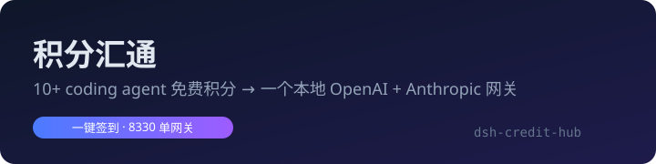

<p align="center">
  
</p>

<p align="center">
  <b>把 10 个 coding agent 的免费积分，汇成一个本地 OpenAI + Anthropic 兼容网关</b>
</p>

<p align="center">
  <a href="https://github.com/Alex663028/dsh-credit-hub/blob/main/LICENSE"></a>
  <a href="#-渠道来源"></a>
  <a href="#-功能"></a>
  <a href="#-网关接入"></a>
  
  
</p>

<p align="center">
  DeepSeek Harness（DSH）插件 · 腾讯 CodeBuddy/WorkBuddy · 商汤小浣熊 · Qoder · TRAE · ZCode · MiniMax Code · Cline · Loomy · LobsterAI · Gemini
</p>

---

## 这是什么

`dsh-credit-hub`（积分汇通）把各家 coding agent 的**账号积分渠道**与**自填的官方 API / 中转**，
汇成一条统一模型车道和一个本地 **OpenAI + Anthropic 兼容网关**（`127.0.0.1:8330`）。

装好后，聊天框模型选择器里会出现「积分汇通」分组；外部工具（Cherry Studio、Codex、Claude Code、curl…）把网关地址一填即可用同一批免费额度。

```
DSH 设置 → 积分汇通
├─ 总览      汇通模型清单 / 各来源状态 / 一键签到 / 开关
├─ 账号渠道   WorkBuddy 原生 + channel-pack 渠道：登录 / 账号池 / 积分
├─ API 中转   预设 + 自定义上游（OpenAI 兼容 / Anthropic 兼容），填 Key 即接入
├─ 降级链     把汇通目录里的模型串成链（fallback / round-robin），提交前失败自动换下一跳
├─ 网关      127.0.0.1:8330（可改端口），/v1/chat/completions + /v1/messages + /v1/models
└─ 日志      逐条运行日志
```

## ✨ 功能

- **一键签到**：总览页一个按钮，并行领取全部在用渠道积分 + WorkBuddy 国内账号签到；「今天已签到」自动算成功，不报红。
- **账号积分渠道 10+**：Raccoon 小浣熊、Qoder/QoderCN、TRAE、Cline、Loomy、MiniMax Code、ZCode、Gemini、LobsterAI、WorkBuddy/CodeBuddy——登录一次，长期使用。
- **OpenCode 匿名免费车道**：`pk/opencode/*` 免费模型（DeepSeek V4.1 Flash Free、GLM 5.3 Flash Free 等）零成本汇入网关。
- **API 中转预设 13 个**：DeepSeek、Z.ai、Kimi、MiniMax、SiliconFlow、OpenRouter、百炼、阶跃、Anthropic、SenseNova、火山方舟（豆包）、百度千帆、魔搭 API-Inference。
- **千帆 AK/SK 自动续期**：填 `AK:SK`，后台自动换 IAM access_token 并在到期前续期，无需手动刷新。
- **降级链**：把模型串成链，失败自动 fallback / round-robin。
- **本地网关**：OpenAI + Anthropic 双协议，模型 id 前缀 `wb/`、`up/`、`pk/`、`combo/`。
- **安全设计**：日志脱敏、凭据 0600 + Windows ACL、管理面仅回环 + 同源。

## 渠道来源

| 来源 | 实现方式 | 说明 |
| --- | --- | --- |
| WorkBuddy / CodeBuddy（腾讯） | 本插件**原生移植**，协议对齐开源 [workbuddy2api](https://github.com/linguo2625469/workbuddy2api-panel)（MIT） | 设备授权流登录、OpenAI 直通 + 出站修正、refresh 单飞（refreshToken 反重放）、错误分类（积分耗尽/限流/风控码）、积分余额与签到。**仅个人自用** |
| Raccoon 商汤小浣熊 / Qoder / Qoder CN / ZCode / MiniMax / TRAE / Cline / Loomy / LobsterAI / Gemini / OpenCode | vendored `channel-pack`（MIT，上游 Jet/iJetLi，见 `vendor/channel-pack/NOTICE.md`） | 登录、账号池、积分领取。渠道模型由 **pack 桥接**（`pk/<provider>/<model>`）并入积分汇通目录，8330 网关与降级链均可直接使用；`accountPack: auto` 时若检测到已装 dsh-our-free-model 则自动跳过，避免双份注册与双重签到 |
| 官方 API / 任意中转 | 本插件原生（openai-chat / anthropic-messages 双线格式） | 内置预设 13 个（含火山方舟、百度千帆、魔搭），也支持任意 OpenAI 兼容中转站 |

## 网关接入

```
# OpenAI 兼容
base_url = http://127.0.0.1:8330/v1     api_key = 网关页显示的 Key
POST /v1/chat/completions · GET /v1/models

# Anthropic 兼容（Claude Code / Codex 等）
ANTHROPIC_BASE_URL = http://127.0.0.1:8330
POST /v1/messages
```

仅绑定回环地址；Key 落 `{DSH_HOME}/credit-hub/gateway/api-key`（0600 + Windows ACL 收紧）。

**网关 Key 只走请求头**：`Authorization: Bearer <Key>` 或 `x-api-key`。`?key=<Key>` 默认关闭
（Key 会留在 URL / 历史 / Referer），确需兼容旧客户端时在设置里开 `allowQueryKey`。
管理面 `/api/credit-hub` 只接受回环 Host + 同源/回环 Origin，跨站与 DNS rebinding 一律 403；
`/gateway` 同时返回 `keyFingerprint` 便于核对。若要更强的写保护，可设置 `adminKey`，
之后所有非 GET 请求必须带 `x-credit-hub-admin: <adminKey>`（设置页本身不带该头，故默认关闭）。

模型 id 前缀：`wb/`（WorkBuddy 原生）、`up/`（自填上游）、`pk/`（渠道包桥接）、`combo/`（降级链）。

## 数据与凭据

- 数据目录：`{DSH_HOME}/credit-hub/`（settings.json / routes.json / accounts.json / usage.json / gateway/ / channel-pack/ / logs.jsonl）
- WorkBuddy token 与上游 API Key 只写 `accounts.json`（0600 原子写 + fsync），管理接口只回 `hasKey` 与指纹
- **Windows ACL**：Node 的 0600 在 Windows 只影响只读位，所以首次写凭据文件时会 best-effort 调 `icacls`
  去掉继承并只授权当前用户；失败不影响写入。也可手动执行
  `icacls "<文件>" /inheritance:r /grant:r "$env:USERDOMAIN\$env:USERNAME:(F)"`
- **日志脱敏**：网关只记 method / 模型 / 字节数 / 消息条数，**不记请求体**；历史日志读出一律把
  `body=...` 替换为 `[redacted]`。超过 1MB 轮换成 `.old` 并清掉上一份，不会无限堆积。
  逐模型用量 `usage.json` 节流落盘，进程重启不再清零。
- channel-pack 状态隔离在 `{DSH_HOME}/credit-hub/channel-pack/`。旧版因 pack 内部又拼一层，文件实际落在
  `channel-pack/channel-pack/`；**v0.2.1 起读写同时兼容两层路径，既有账号/积分数据无需迁移**。
- **平台差异**：0600/0700 权限位只在 POSIX 生效；Windows 下 Node 的 mode 仅影响只读位，
  凭据文件实际以用户 profile 目录的 ACL 保护。如需系统级凭据托管，后续可接入宿主
  `dsh-credentials` 服务（已在 peerDependencies 声明，全部标记为 optional）

## 安装

### 方式一：npm（推荐，开箱即用）

```powershell
# 在 {DSH_HOME}/profiles/desktop/package.json 的 dependencies 加入：
#   "dsh-credit-hub": "^0.3.0"
# 并把 "dsh-credit-hub" 加入 dsh.profile.bundles，然后：
cd {DSH_HOME}/profiles/desktop
pnpm install
```

重启 DSH，设置 → 积分汇通即出现。

### 方式二：本地源码（开发 / 改源码即时生效）

```powershell
git clone https://github.com/Alex663028/dsh-credit-hub.git
```

在 `{DSH_HOME}/profiles/desktop/package.json`（桌面端）的 `dependencies` 加：

```json
"dsh-credit-hub": "link:<克隆路径>/dsh-credit-hub"
```

并把 `"dsh-credit-hub"` 加入 `dsh.profile.bundles`，然后重启 DSH。设置 → 积分汇通。

> `link:` 便于改源码即时生效；pnpm 会提示「linked in dependency will not resolve peer dependencies」——
> 这是 `link:` 的固有行为，插件运行态只依赖宿主 `ctx` 提供的服务，`@deepseek-ai/schemastery` 缺失时
> 配置面板降级并打印一条明确告警，不影响网关与模型车道。**发布到插件市场时建议改用 `file:` 协议**。
> `client.js` 有 IIFE + 幂等守卫，宿主重复注入也只会注册一次，不需重启 DSH。

## 使用声明（必读）

- 本插件仅供**管理自己的账号**：自动签到、保活、给本地工具提供统一入口。不支持、不授权任何
  批量小号、额度转卖、卡密分发——那些行为违反平台服务条款，风险自担。
- 各渠道均为非官方客户端接入，平台随时可能收紧识别（WorkBuddy 上游 2026-10 已开始；
  workbuddy2api 项目因此停更）。由此导致的账号风控/封禁由使用者自行承担。
- refresh 单飞是硬约束：WorkBuddy 的 refreshToken 上游反重放，并发第二发会整条链作废（12153），
  本插件已按账号串行化，请勿同时跑多份指向同一账号的网关。

## 相关话题（Topics）

`dsh` · `deepseek-harness` · `coding-agent` · `free-api` · `llm-proxy` · `openai-compatible`
`workbuddy` · `codebuddy` · `raccoon` · `qoder` · `trae` · `zcode` · `minimax` · `gemini`
`积分汇通` · `免费模型` · `白嫖`

## 许可

MIT。`vendor/channel-pack/` 为 MIT 再分发（见其 NOTICE.md 与 LICENSE）。